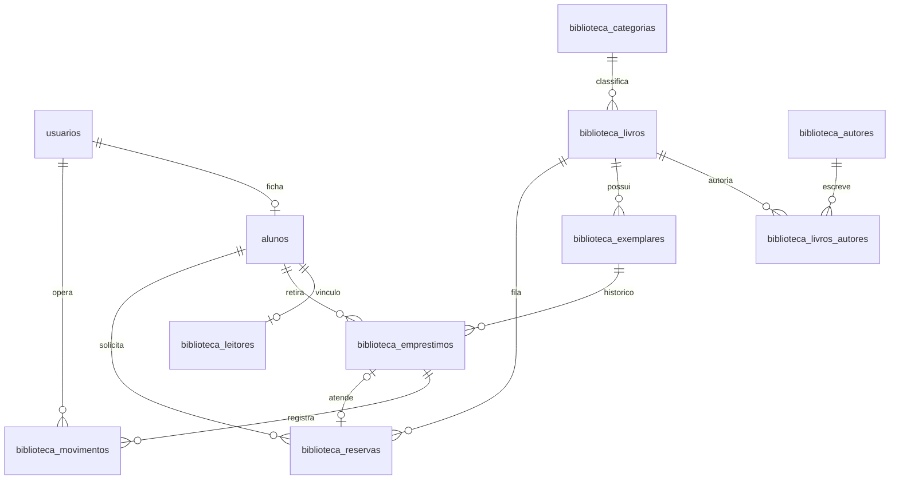

# Alexandr.IA — Sprint 1: fases 2.1 a 2.4

Conclusão local: **16/11/2026**. Somente workspace Alexandr.IA. Não houve commit, push, publicação Pages, deploy ou alteração de outro projeto.

## Resultado executivo

O sistema autenticado agora consulta/persiste acervo, fichas de leitores, empréstimos/devoluções e reservas/renovações no PostgreSQL. A demo Pages permanece independente, com fixtures e sem API.

| Checkpoint, em ordem | Aprovados | Falhos | Ignorados |
| --- | ---: | ---: | ---: |
| Base inspecionada | 160 | 0 | 0 |
| 2.1 Acervo | 166 | 0 | 0 |
| 2.2 Leitores | 170 | 0 | 0 |
| 2.3 Circulação | 176 | 0 | 0 |
| 2.4 + revisão final | 185 | 0 | 0 |

TypeScript, build autenticado (/painel/) e build Pages (/Alexandr.IA/) foram executados em cada checkpoint. Revalidação final em 16/11/2026. Nenhuma dependência ou lockfile foi alterado. Não se declara homologação visual/produção a partir desses testes.

Documentação por fase: [2.1](sprint1-21.md), [2.2](sprint1-22.md), [2.3](sprint1-23.md), [2.4](sprint1-24.md).

## Modelo de dados

Quatro novas migrations, sem editar 001–003:
- 004: biblioteca_autores, biblioteca_categorias, biblioteca_livros, biblioteca_livros_autores e biblioteca_exemplares.
- 005: biblioteca_leitores, somente habilitação/versão do vínculo operacional de alunos.
- 006: biblioteca_emprestimos e biblioteca_movimentos.
- 007: biblioteca_reservas.

São nove tabelas novas; usuarios, alunos e sessoes continuam sendo as estruturas originais de conta, ficha e sessão. Não há exclusão física via API.

Um título/obra pode ter vários exemplares com patrimônios distintos. Uma reserva é da obra; o exemplar é escolhido posteriormente na retirada. ISBN, patrimônio, autoria e vínculos têm constraints/índices; FKs preservam histórico. Editoras são texto opcional, sem cadastro independente nesta sprint.

## Lista completa dos novos endpoints

Prefixo: **/api/biblioteca**. Todos exigem sessão/usuário ativo e perfil conhecido. Toda mutação exige origem permitida e o token CSRF já existente.

| Método | Caminho | Acesso |
| --- | --- | --- |
| GET | /livros | Todos os três perfis |
| GET | /livros/:id | Todos |
| POST | /livros | Bibliotecário/administrador |
| PUT | /livros/:id | Equipe; versão obrigatória |
| GET | /livros/:id/exemplares | Todos |
| POST | /livros/:id/exemplares | Equipe |
| PUT | /exemplares/:id | Equipe; versão, estado e conservação |
| GET | /meu-perfil | Aluno, exclusivamente pela sessão |
| GET | /leitores | Equipe |
| GET | /leitores/:id | Equipe |
| POST | /leitores | Equipe, cadastro sempre aluno |
| PUT | /leitores/:id | Equipe, ficha e habilitação |
| GET | /politica | Todos |
| GET | /emprestimos | Aluno próprios; equipe todos |
| GET | /emprestimos/:id | Titular aluno ou equipe |
| POST | /emprestimos | Equipe |
| POST | /emprestimos/:id/devolucao | Equipe |
| GET | /reservas | Aluno próprias; equipe todas |
| GET | /reservas/:id | Titular aluno ou equipe |
| POST | /livros/:id/reservas | Aluno; titular pela sessão |
| POST | /reservas/:id/cancelamento | Titular ou equipe |
| POST | /emprestimos/:id/renovacao | Titular aluno |

GETs de lista aceitam pagina/limite (padrão 10, máximo 50). Catálogo aceita q/autor/categoria. Empréstimos/reservas aceitam q/estado e leitor_id restrito a equipe. Consulta de IDs de outro aluno não revela seu registro. Nenhuma API retorna senha/hash/token de sessão ou contato de leitores em massa.

Sucesso de POST é 201 (evento/registro criado), PUT/GET 200. Erros: 400 validação, 401 sessão, 403 permissão/origem/CSRF, 404 recurso não acessível/encontrado, 409 conflito/duplicidade/transição/versão, 413 corpo, 429 limite, 503 configuração/conexão, 500 erro interno genérico. Escritas não repetem automaticamente.

As rotas de login/cadastro, /api/me, /api/csrf, /logout, /painel/, /area e /static permanecem como documentadas no README. Recuperação de senha continua 501. Cookies, CORS e o mecanismo de autenticação não foram relaxados.

## Fluxos e telas

### Acervo
Equipe abre Acervo, cadastra obra com autores/categoria/ISBN/editora opcionais, edita por versão e registra exemplares por patrimônio. Pode alterar estado/conservação após devolução. Aluno pesquisa catálogo, consulta dados bibliográficos e exemplares. Disponibilidade calculada exclui impedimento físico e empréstimo ativo; retirada ainda depende de fila/política.

### Leitores
Equipe pesquisa nome/RA, pagina a lista, cadastra aluno com o fluxo Argon2 existente, atualiza nome/RA/curso e habilitação. Não altera perfil, e-mail ou senha por essa edição. Aluno vê Meu perfil. Não há leitores externos nem promoção pública. Habilitação da biblioteca não modifica a conta de acesso.

### Empréstimo e devolução
Equipe abre Empréstimos → Novo empréstimo, pesquisa leitor/obra, escolhe exemplar elegível e confirma. O servidor calcula prazo pela configuração aprovada, verifica vínculo/conta/limite/fila e grava o movimento. Devolução confirma o registro e libera elegibilidade física; não promete reserva atendida automaticamente. Ativos/histórico/atrasados e busca são reais. Aluno vê somente seus empréstimos, datas, exemplar e situação.

### Reservas e renovações
Aluno solicita reserva no catálogo e acompanha Minhas reservas. Cancela somente a própria reserva aguardando. Equipe consulta a fila em Empréstimos → Reservas, pode cancelar com motivo e atende ao registrar a retirada para o primeiro leitor. Renovação só pelo titular, dentro do prazo, limite explícito e sem fila incompatível. Mensagens de sucesso dependem de resposta da API.

Visão geral, Relatórios e controles de privacidade ainda identificados como demonstrativos não foram convertidos em dados reais. Configurações de acessibilidade continuam locais. Não foram criados indicadores fictícios com aparência de métricas reais das novas operações.

## Políticas pendentes de decisão institucional

Não foram inventadas regras oficiais da Fatec. O responsável deve definir em seu ambiente:
- LIBRARY_LOAN_DAYS: prazo da retirada, inteiro 1–365.
- LIBRARY_MAX_LOANS: ativos por aluno, inteiro 1–100.
- LIBRARY_RENEWAL_DAYS: acréscimo por renovação, inteiro 1–365.
- LIBRARY_MAX_RENEWALS: inteiro 0–20; zero desabilita.

Faixas são limites técnicos, não recomendações institucionais. Não há valores padrão: retiradas/renovações ficam indisponíveis enquanto a configuração correspondente estiver incompleta/inválida. Reservas funcionam como pedidos aguardando, sem garantia de prazo de atendimento.

FIFO, uma pendência por obra/aluno, recusa de reserva da obra já emprestada ao titular e recusa de renovação vencida são propostas conservadoras documentadas. Não há multa, expiração de reserva, fura-fila ou bloqueio financeiro automático. Contas de equipe não são criadas automaticamente. Um operador autorizado deve preparar previamente contas fictícias de bibliotecário/administrador para homologação; esta sprint não introduziu gestão de perfis ou credenciais padrão.

## Concorrência, segurança e aprendizado

Transação confirma ou reverte o conjunto de mudanças. Bloquear uma linha da obra antes de alterar fila/circulação permite que duas operações concorrentes revalidem as condições na ordem efetiva. O leitor também é bloqueado para serializar limites em obras diferentes.
O índice único parcial protege somente os empréstimos ativos de cada exemplar, preservando vários registros históricos devolvidos. Uma restrição semelhante evita duas reservas pendentes do mesmo aluno/obra. Detalhes: [bloqueios PostgreSQL 17](https://www.postgresql.org/docs/17/explicit-locking.html) e [índices parciais](https://www.postgresql.org/docs/17/indexes-partial.html).

O backend decide permissões e propriedade; o frontend só apresenta as opções. Token CSRF impede que uma mutação autenticada seja aceita só por ter cookie. Parâmetros SQL separam dados de instruções. Versões detectam edição desatualizada; nenhum sucesso é mostrado antes da confirmação. Logs HTTP novos não imprimem dados de entrada, credenciais ou tokens.

Nível padrão READ COMMITTED e ordem obra → leitor → linhas operacionais. Deadlock/serialização vira 409 com rollback. A garantia não substitui controle de acesso SQL direto por administradores; migrations/comandos externos também precisam respeitar as regras.

## Testes, erros encontrados e limites da evidência

A execução usou somente PostgreSQL temporário 17.10, loopback 55439, banco alexandria_test; nenhuma migration foi aplicada a desenvolvimento ou produção. Node 24.22.3, npm 11.19.1, React 19.2.4, TypeScript 5.9.3, Vite 8.0.5 e pnpm 10.34.3.
Os testes aplicam migrations no banco explicitamente de teste, criam fixtures fictícias e removem seus registros. Os testes SQL antigos continuam usando rollback. Não houve truncate ou limpeza global.

Casos novos: validação/SQL injection como texto, paginação, perfis, CSRF/origem, versões, patrimônio único, ficha própria e recusa horizontal, concorrência pelo exemplar, limite em obras distintas, rollback, atrasos, fila e posição, reserva duplicada concorrente, cancelamento contra atendimento, renovação concorrente/limite/prioridade e UI sem sucesso antecipado.

Foram corrigidos durante os checkpoints: foco no título do catálogo (assert de DOM resultou inicialmente em falha de memória no diagnóstico), status 400 do cadastro administrativo reutilizado e query com nome de parâmetro inesperado. Foram acrescentadas validações de IDs numéricos sem precisão segura e alinhada a hierarquia de títulos de aluno/equipe. Nenhum teste foi dispensado.
Ao retomar após interrupção, o cluster temporário concluiu sua recuperação antes da execução; não foram apagados arquivos de PID/WAL nem alterados serviços de produção.

185 testes aprovados, zero falhas/cancelados/ignorados, com TypeScript e ambos os builds. Testes de componentes são DOM emulado; não comprovam aparência, leitor de tela, zoom/reflow ou aparelhos físicos. O checklist abaixo continua pendente de execução humana. O cluster temporário foi encerrado ao finalizar.

## Arquivos criados e modificados

Criados:
- backend/library/common.js, catalog.js, readers.js, circulation.js, reservations.js e router.js.
- database/migrations/004_create_acervo.sql, 005_create_vinculo_leitor.sql, 006_create_circulacao.sql e 007_create_reservas.sql.
- frontend/src/library/api.ts, Catalog.tsx, Readers.tsx, Loans.tsx, Reservations.tsx, StudentLibrary.tsx, CirculationArea.tsx e library.css.
- tests/library.test.js.
- docs/sprint1-21.md, sprint1-22.md, sprint1-23.md, sprint1-24.md, sprint1-relatorio.md, sprint1-frontend.sha256.json e sprint1-integridade.sha256.json.

Modificados:
- backend/app.js: montagem do novo router, sem substituir autenticação.
- frontend/src/App.tsx, LibraryPanel.tsx, components/AuthGate.tsx, hooks/useNavigation.ts e main.tsx: integração das vistas reais, experiência do aluno, foco e CSS próprio.
- tests/database.test.js: espera as sete migrations; tests/painel.test.js: extensão do encadeamento de hashes; tests/react-auth.test.js: novas telas reais e testes da demo explicitamente separados.
- .env.example: somente nomes/comentários de políticas, sem segredos.
- README.md: estado atual, configuração e documentação.

Preservados: migrations 001–003, os 13 arquivos login, módulos de sessão/CSRF/login, lockfiles/dependências, entrada demo e workflow manual. Manifestos antigos não foram regravados. Novo registro de integridade identifica a base Git e os hashes antes/depois; não é autorização para publicar.

## Roteiro de homologação manual — pendente

1. Preparar banco local separado para homologação, com credenciais locais próprias, conforme README. Não usar dados reais. Executar migrations explicitamente somente no destino autorizado.
2. Responsável define as quatro políticas; não copiar valores dos testes como regra da Fatec. Reiniciar o servidor após configurar.
3. Gerar build real/demo, iniciar Express, conferir login e perfis. Contas de equipe fictícias devem ser preparadas por responsável autorizado; cadastro público continua aluno. Não promover/excluir ficha de estudante com histórico para conseguir demonstrar a interface.
4. Equipe: Acervo → cadastrar obra fictícia, autores/categoria e dois patrimônios. Pesquisar, filtrar, editar e conferir conflito em duas abas. Patrimônio repetido deve falhar.
5. Aluno: pesquisar catálogo, ver detalhes/estoque; não deve encontrar controles de alteração. Tentar URL de outro perfil não concede acesso.
6. Equipe: Leitores → pesquisar/paginar, cadastrar aluno fictício, editar ficha/vínculo. Aluno: Meu perfil deve conter só seus próprios dados.
7. Registrar retirada do primeiro exemplar. Conferir prazo e contagem de disponíveis. Outra tentativa do mesmo exemplar deve falhar; aluno não pode registrar devolução.
8. Conferir Meus empréstimos no aluno e ativos/histórico/atrasados na equipe. Não editar datas diretamente em banco de desenvolvimento para forçar um atraso.
9. Outro aluno solicita reserva da mesma obra. Conferir posição e que ela não promete exemplar alocado; tentativa de renovação do titular deve ser recusada.
10. Cancelar reserva pelo titular; conferir que aluno diferente não pode cancelar. Cancelamento administrativo precisa de motivo sem dados pessoais.
11. Sem pendência incompatível e dentro do prazo, solicitar renovação e aguardar API. Conferir limite e datas reais. Repetição além do limite deve falhar.
12. Equipe registra devolução, depois atende o primeiro da fila por Novo empréstimo. Reserva passa a atendida associada à retirada, sem sucesso antecipado.
13. Conferir logout, retorno após expiração e conta/vínculo inabilitado em ambiente fictício. Não capturar cookies, senhas, CSRF ou dados reais.
14. Desktop/tablet/celular: menu, Escape, foco após seção/aba, formulários e confirmações por teclado, temas, texto ampliado e zoom. Usar Narrador; registrar navegador/versão, viewport, resultado e evidência sanitizada.
15. Conferir prévia demo Pages local: aviso acadêmico, seis seções fictícias e nenhuma API. Não acionar o workflow ou publicar nesta sprint.

## Pendências e próxima fase

Antes de uso institucional: aprovar políticas e propostas conservadoras, homologar visualmente/teclado/leitor de tela, preparar equipe autorizada e revisar requisitos de proteção de dados/operação. Esta execução local não autoriza produção.

Limitações conhecidas: seleção de obra/leitor na retirada mostra até 50 opções por pesquisa (refinar termos); fila não expira automaticamente; não há leitores externos, multas, notificações ou gestão de perfis; não há exclusão de histórico nem relatório agregado real. Disponibilidade é revalidada na retirada e pode mudar depois da consulta. Se uma atualização sofrer 409, recarregar os dados/cancelar a edição antiga antes de reenviar; não sobrescrever à força.

Próxima fase apenas mediante autorização. Atualizações funcionais da demo pertencem à 2.6 e não foram iniciadas. Nenhuma publicação ou ação em projetos 4CODE/ASTRA foi executada.

## Evidencia final de preservacao e limpeza de fixtures

A consulta final ao banco temporario confirmou PostgreSQL 17.10, migrations 001 a 007 e zero registros nas nove tabelas biblioteca_* apos a limpeza das fixtures pelas suites. Nenhum dado pessoal foi consultado para esta evidencia: somente versao, nomes de migrations/tabelas e contagens.
A comparacao com a base Git confirmou os 13 arquivos login, migrations 001-003, lockfiles e todos os manifestos historicos byte a byte. O index permaneceu inalterado. A busca de padroes de credenciais/chaves/tokens nos arquivos alterados/novos nao identificou segredos; nao substitui revisao humana antes de publicacao.
Escopo final: 37 arquivos (11 modificados e 26 criados), incluindo o novo registro de integridade. Arquivos gerados, logs de testes e caches continuam ignorados e nao foram selecionados para commit.

Na revisao de feedback, as quatro telas reais deixaram de apresentar lista vazia como resultado de uma consulta com erro. O teste do catalogo confirma o estado 503 sem mensagem falsa de ausencia de livros. A mensagem de renovacao desabilitada tambem cobre limite zero sem prometer habilitacao automatica.

A verificacao final separou explicitamente NODE_ENV=production durante os dois builds e NODE_ENV=test na suite PostgreSQL/React. Os bundles finais foram gerados sem publicar artefatos; a demo permaneceu com cinco arquivos estaticos sem endpoints de autenticacao.
